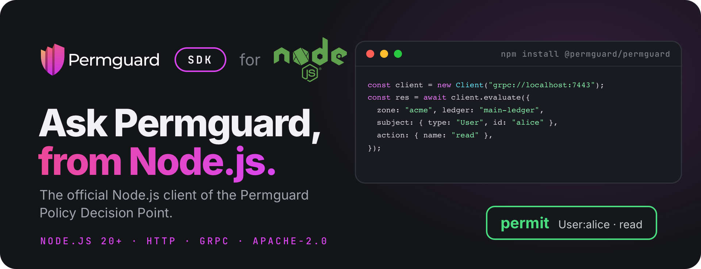

<!--
Copyright (c) 2022 Nitro Agility S.r.l.
SPDX-License-Identifier: Apache-2.0
-->

# Permguard Node.js SDK

[](https://www.npmjs.com/package/@permguard/permguard)
[](https://github.com/permguard/sdk-node/actions/workflows/sdk-node-ci.yml)
[](https://www.apache.org/licenses/LICENSE-2.0)

<p align="center">
  
</p>

<p align="center">
  <a href="https://github.com/permguard/permguard"><b>Permguard</b></a> ·
  <a href="https://docs.permguard.com/"><b>Documentation</b></a> ·
  <a href="#install"><b>Install</b></a> ·
  <a href="#quick-start"><b>Quick start</b></a> ·
  <a href="#develop"><b>Develop</b></a>
</p>

**The official Node.js client of the Permguard Policy Decision Point.**

Before your code acts, it asks Permguard whether a subject may perform an action on a resource, and Permguard answers from the policies of a ledger.
This SDK is how JavaScript and TypeScript code on Node.js asks: one client for the native, stateless PDP interface `permguard.api.pdp.native.v1`, over HTTP/JSON or gRPC, with the same request and the same answer on both.

<p align="center">
  
</p>

<p align="center"><sub>Your code asks, the SDK carries the question, the data plane decides with the ledger's policies.</sub></p>

## Install

The SDK needs Node.js 20 or newer, and ships its TypeScript types.

```bash
npm install @permguard/permguard
```

It needs a Permguard data plane to ask: by default it listens on port `7443`, for HTTP and gRPC alike.
See the [Permguard repository](https://github.com/permguard/permguard) to run one.

## Quick start

```typescript
import { Client, Refusal } from "@permguard/permguard";

// grpc:// or grpcs:// speaks gRPC; http:// or https:// speaks JSON.
const client = new Client("grpc://localhost:7443");

try {
  const response = await client.evaluate({
    zone: "acme",
    ledger: "main-ledger",
    profile: "gateway",
    subject: { type: "User", id: "alice" },
    resource: { type: "Document", id: "budget-2026" },
    action: { name: "read" },
    requestId: "example-1",
  });
  console.log("permitted:", response.decision);
} catch (error) {
  if (error instanceof Refusal) {
    console.error(`refused: class=${error.errorClass} code=${error.code} message=${error.message}`);
  } else {
    throw error;
  }
} finally {
  client.close();
}
```

The package ships both an ES module and CommonJS.
The snippets here use top-level `await`, which needs an ES module; in CommonJS, put them in an `async` function, as [examples/cmd](examples/cmd/src/index.ts) does.
Set `PERMGUARD_PDP_URL` to point that example at another data plane.

### The request

| Field             | What it says                                                            |
| ----------------- | ----------------------------------------------------------------------- |
| `zone`, `ledger`  | the ledger whose policies decide, in its zone                           |
| `profile`         | the profile of the ledger's manifest that selects the partitions to run |
| `subject`         | who asks: a type and an id, with optional properties                    |
| `resource`        | what is acted on: a type and an id, with optional properties            |
| `action`          | what is done: a name, with optional properties                          |
| `context`         | any other fact the policies read                                        |
| `partitionInputs` | runtime data for the partitions of the profile, see below               |
| `requestId`       | your id for the call, given back in the answer                          |

### The answer

A deny is not an error: it is a successful response with `decision === false`.
Validation, authorization, availability and server failures reject with `Refusal`, with their stable `errorClass` and `code`.

## Partition inputs

Runtime data is addressed to the partition name the ledger's profile declares:

```typescript
const response = await client.evaluate({
  zone: "acme",
  ledger: "main-ledger",
  partitionInputs: {
    authorization: {
      type: "permguard.cedar.entities.v1",
      data: [
        {
          uid: { type: "Team", id: "engineering" },
          attrs: { active: true },
          parents: [],
        },
      ],
    },
  },
});
```

The key is a partition name from the selected profile.
`type` asserts the partition's input contract; it does not select a policy runtime.

## Many evaluations at once

Set the defaults on the request, list the `evaluations`, and call `evaluateMany`:

```typescript
import { EvaluationsSemantic } from "@permguard/permguard";

const response = await client.evaluateMany({
  zone: "acme",
  ledger: "main-ledger",
  subject: { type: "User", id: "alice" },
  evaluations: [
    {
      resource: { type: "Document", id: "budget-2026" },
      action: { name: "read" },
      requestId: "read",
    },
    {
      resource: { type: "Document", id: "budget-2026" },
      action: { name: "update" },
      requestId: "update",
    },
  ],
  options: { evaluationsSemantic: EvaluationsSemantic.ExecuteAll },
});
```

An evaluation with no `partitionInputs` inherits the request's.
An explicit empty object replaces them with no inputs, and the SDK keeps that difference over HTTP and gRPC.

## Endpoints and options

| Endpoint   | Transport                                      |
| ---------- | ---------------------------------------------- |
| `http://`  | JSON over HTTP                                 |
| `https://` | JSON over HTTPS                                |
| `grpc://`  | `permguard.data.v1.PolicyDecisionPoint`        |
| `grpcs://` | `permguard.data.v1.PolicyDecisionPoint` on TLS |

```typescript
const client = new Client("https://pdp.example.com", {
  timeoutMs: 5_000,
  headers: { authorization: `Bearer ${token}` },
});

const configuration = await client.getConfiguration();
const response = await client.evaluate(request, {
  timeoutMs: 1_000,
  signal: abortController.signal,
});
```

| Option              | Sets                                       |
| ------------------- | ------------------------------------------ |
| `timeoutMs`         | the timeout of every call                  |
| `headers`           | static headers, also sent as gRPC metadata |
| `tls`               | the TLS options for `https://`             |
| `grpcCredentials`   | the `ChannelCredentials` for `grpcs://`    |
| `grpcClientOptions` | the options of the gRPC client             |

Every call also takes its own `timeoutMs` and an `AbortSignal`.
`getConfiguration` reads the data plane's discovery document.

## Compatibility

This major version implements `permguard.api.pdp.native.v1`.
Compatibility is tied to that versioned interface, not to a server minor version.

## Develop

```bash
npm ci
npm run generate-grpc
npm run typecheck
npm test
npm pack --dry-run
```

The protobuf source mirrors the native stateless contract in the Permguard server repository: regenerate the bindings whenever it changes.

## License

Apache License 2.0: see [LICENSE](LICENSE), [NOTICE.md](NOTICE.md) and [THIRD_PARTY_NOTICES.md](THIRD_PARTY_NOTICES.md).

Permguard is a trademark of Nitro Agility S.r.l., see [TRADEMARKS.md](TRADEMARKS.md).
Node.js and the Node.js logo are trademarks of the OpenJS Foundation, shown only to name the runtime this SDK is for.
